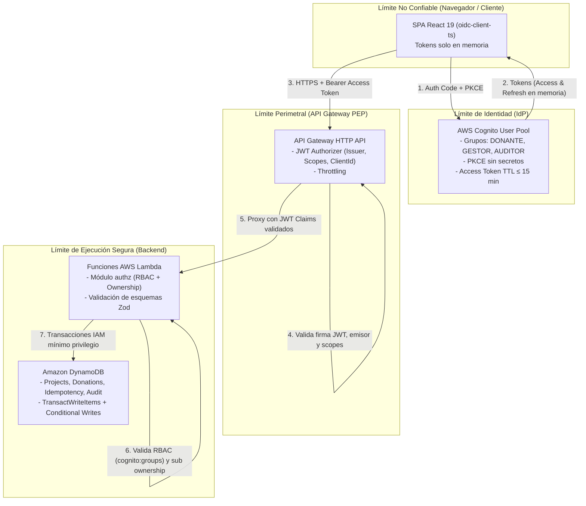

# Modelo de Amenazas y Diseño de Seguridad Zero Trust

**Proyecto:** Plataforma de Donaciones Seguras  
**Responsable:** Paolo Ramírez (Identidad y Seguridad Zero Trust)  
**Fecha:** 2026-11-08  
**Versión:** 1.0  

---

## 1. Introducción y Alcance

La **Plataforma de Donaciones Seguras** es una solución web serverless diseñada bajo el paradigma **Zero Trust** («*Never trust, always verify*»). La arquitectura se compone de:
- Una **SPA en React** que se ejecuta en el navegador del cliente.
- Un **Proveedor de Identidad (IdP)** basado en **AWS Cognito User Pools** con soporte para autenticación OIDC / OAuth 2.0 (Authorization Code Flow con PKCE).
- Un punto de control de acceso perimetral (**PEP**) implementado en **AWS API Gateway HTTP API** mediante un **JWT Authorizer**.
- Una capa de procesamiento desacoplada basada en **AWS Lambda** que actúa como **PDP/PEP de aplicación**, validando scopes, roles RBAC y pertenencia (*ownership*).
- Un almacén de datos persistente en **Amazon DynamoDB** con transacciones ACID y aislamiento mediante políticas IAM de mínimo privilegio.

El presente documento formaliza el **Modelo de Amenazas STRIDE**, la definición del **Flujo de Datos y Límites de Confianza**, el **Diseño de Scopes OAuth 2.0 / Cognito**, la **Matriz de Control de Acceso** y el análisis de la **Limitación de Revocación de Tokens JWT** (CA-03.4).

---

## 2. Diagrama de Flujo de Datos (DFD) y Límites de Confianza

El sistema delimita estrictamente cuatro fronteras de confianza (*Trust Boundaries*):



### Límites de Confianza:
1. **TB-01: Frontera Cliente-Perímetro (Internet / Browser):** El navegador se considera un entorno completamente hostil y no confiable. Ningún estado o decisión tomada en el cliente (como ocultar botones de la interfaz) es vinculante para la seguridad. Los tokens deben residir exclusivamente en memoria volátil de la aplicación.
2. **TB-02: Frontera de Identidad (Cognito IdP):** Emisor criptográfico de tokens JWT firmados con RS256. Emite Access Tokens con tiempo de vida limitado ($\le 15$ minutos) y scopes asociados al Resource Server `api`.
3. **TB-03: Frontera Perimetral (API Gateway HTTP API):** Primer punto de observabilidad y control (Policy Enforcement Point - PEP). Valida la firma del token contra las claves públicas JWKS de Cognito, el emisor (`iss`), la audiencia/cliente (`client_id`) y la presencia de scopes necesarios para la ruta solicitada.
4. **TB-04: Frontera de Dominio y Datos (Lambda & DynamoDB):** Segundo punto de control (Policy Decision Point / Policy Enforcement Point de aplicación). Inspecciona los claims deserializados (`cognito:groups` para RBAC y `sub` para *ownership* de recursos) y ejecuta operaciones transaccionales seguras sobre DynamoDB.

---

## 3. Análisis STRIDE de Amenazas y Mitigaciones

| Categoría STRIDE | Amenaza Identificada | Impacto | Nivel de Riesgo | Controles y Mitigaciones Implementadas |
| :--- | :--- | :--- | :---: | :--- |
| **Spoofing** (Suplantación) | **S-01:** Atacante falsifica un token JWT o utiliza claves arbitrarias para suplantar a otro usuario. | Acceso no autorizado total a operaciones de donación o gestión. | **Crítico** | Verificación criptográfica obligatoria con firma RS256 contra el endpoint JWKS oficial de Cognito (`iss` y `client_id` validados en API Gateway y Lambda). |
| **Spoofing** (Suplantación) | **S-02:** Atacante envía un **ID Token** en lugar de un **Access Token** en el encabezado `Authorization: Bearer` (CA-NF02.1 / T02). | Un ID Token describe identidad pero no autorización de acceso a APIs de recursos. | **Alto** | El authorizer valida explícitamente `token_use === 'access'`. Los ID Tokens carecen del claim `scope` y son rechazados automáticamente con **HTTP 401 Unauthorized** (`ID_TOKEN_REJECTED`). |
| **Spoofing** (Suplantación) | **S-03:** Robo o filtración de tokens mediante ataques XSS en la SPA. | Suplantación de sesión activa del donante o gestor. | **Alto** | `oidc-client-ts` configurado para mantener tokens **exclusivamente en memoria** (nunca en `localStorage` ni `sessionStorage`). Implementación de Content Security Policy (CSP) restrictiva y Access Token con expiración máxima de 15 minutos. |
| **Tampering** (Manipulación) | **T-01:** Modificación en tránsito del monto de donación (`amountCents`) o del `projectId`. | Alteración fraudulenta del importe donado. | **Crítico** | Encriptación en tránsito con TLS 1.3 / 1.2 obligatorio. Validación rigurosa de contratos con esquemas Zod en Lambda (`amountCents` entre 100 y 100000 céntimos). |
| **Tampering** (Manipulación) | **T-02:** Reenvío de solicitudes con la misma `Idempotency-Key` pero variando el payload para vulnerar la integridad (CA-05.4). | Corrupción de integridad contable o transaccional. | **Alto** | Generación de hash criptográfico `payloadHash` (SHA-256) verificado atómicamente en DynamoDB mediante `TransactWriteItems`. Si el hash difiere, se rechaza con **HTTP 409 Conflict**. |
| **Tampering** (Manipulación) | **T-03:** Modificación arbitraria del estado de un proyecto (ej. marcar como `PUBLICADO` sin ser gestor). | Publicación no autorizada de campañas fraudulentas. | **Alto** | Verificación RBAC en Lambda (`requireRole(ctx, 'GESTOR')`) y expresiones de condición en DynamoDB (`attribute_not_exists` o estado actual). |
| **Repudiation** (Repudio) | **R-01:** Donante afirma no haber autorizado una intención de donación o simulación. | Disputas operativas y falta de trazabilidad. | **Medio** | Registro inmutable de eventos de auditoría (`AuditEvents`) con timestamp UTC, `requestId` de API Gateway y `donorSub` extraído directamente del token verificado. |
| **Repudiation** (Repudio) | **R-02:** Gestor niega haber publicado o modificado un proyecto de recaudación. | Imposibilidad de imputar responsabilidades administrativas. | **Medio** | Registro de auditoría obligatorio vinculando el `sub` del gestor obtenido del token autenticado con la operación de creación y publicación. |
| **Information Disclosure** (Fuga de Información) | **I-01:** Usuario no autenticado o no autorizado accede a proyectos en estado `BORRADOR` mediante enumeración de IDs. | Fuga de información confidencial o campañas no aprobadas. | **Medio** | Regla de dominio estricta: las rutas públicas `GET /v1/projects/{id}` devuelven **HTTP 404 Not Found** si el proyecto no tiene estado `PUBLICADO`. |
| **Information Disclosure** (Fuga de Información) | **I-02:** Fuga de identificadores personales o datos bancarios del donante. | Violación de privacidad de datos personales. | **Alto** | Principio de minimización: no se procesan datos bancarios reales (simulación académica). En auditoría y logs se emplean exclusivamente identificadores seudonimizados (`sub` opaco). |
| **Information Disclosure** (Fuga de Información) | **I-03:** Respuestas de error con volcados de trazas (stack traces) o nombres de tablas de DynamoDB. | Revelación de la topología interna del backend para atacantes. | **Bajo** | Manejo centralizado de excepciones que transforma todo fallo en un formato estándar y seguro `{ code, message, requestId }` (CA-08.3, RNF-HU-10). |
| **Denial of Service** (Denegación de Servicio) | **D-01:** Inundación volumétrica de solicitudes a endpoints de creación de donaciones o consultas. | Agotamiento de cuotas Lambda o degradación de servicio. | **Alto** | Throttling configurado en API Gateway HTTP API (límite sostenido y ráfaga por IP/ruta). |
| **Denial of Service** (Denegación de Servicio) | **D-02:** Peticiones concurrentes repetidas para incrementar el acumulado de donación más de una vez (RNF-HU-04 / T08). | Sobregiro o duplicación inconsistente de metas de proyectos. | **Alto** | Incremento atómico condicional (`ADD currentAmount :val`) con verificación de estado `CONFIRMADO` una sola vez en DynamoDB. |
| **Elevation of Privilege** (Elevación de Privilegios) | **E-01:** Un usuario con rol `DONANTE` realiza peticiones directas al endpoint de creación o publicación de proyectos (`POST /v1/projects`) (HU-04 / T03). | Creación de campañas por usuarios no facultados. | **Crítico** | Enfoque Zero Trust: la UI oculta botones pero el backend no asume confianza. La API verifica el scope `api/projects.write` en API Gateway y el grupo `cognito:groups === 'GESTOR'` en Lambda; ante discrepancia responde **HTTP 403 Forbidden**. |
| **Elevation of Privilege** (Elevación de Privilegios) | **E-02:** Donante intenta consultar o manipular el historial de donaciones de otro donante (`GET /v1/donations/me`) (CA-07.2 / T09, T12). | Acceso ilícito a registros financieros de terceros. | **Alto** | Verificación de pertenencia (*Ownership*): el backend ignora parámetros externos de identidad y extrae el identificador `donorSub` estrictamente del token JWT verificado en `requestContext`. |
| **Elevation of Privilege** (Elevación de Privilegios) | **E-03:** Acceso a registros de auditoría por usuarios no auditores o sin segundo factor. | Vulneración de la integridad del rastro forense. | **Alto** | Endpoint `GET /v1/audit` restringido exclusivamente a miembros del grupo `AUDITOR`, con scope `api/audit.read` y MFA TOTP obligatorio (HU-10, HU-11). |

---

## 4. Diseño de Scopes OAuth 2.0 y Cognito Resource Server

AWS Cognito permite desacoplar los permisos mediante la definición de un **Resource Server**. En la plataforma se define el Resource Server con identificador `api` (o `https://api.donaciones.seguras`).

### Scopes Definidos:
1. **`api/projects.write`:**
   - **Propósito:** Autoriza operaciones de mutación sobre proyectos (creación de borradores y publicación oficial).
   - **Asignación:** Otorgado a usuarios pertenecientes al grupo `GESTOR`.
2. **`api/donations.*`:**
   - **Propósito:** Autoriza operaciones de donación (registro de intención de donación, consulta de historial propio y ejecución de simulación de cobro).
   - **Asignación:** Otorgado a usuarios pertenecientes al grupo `DONANTE`.
3. **`api/audit.read`:**
   - **Propósito:** Autoriza la lectura y filtrado de eventos de auditoría seudonimizados.
   - **Asignación:** Otorgado a usuarios pertenecientes al grupo `AUDITOR` con MFA verificado.

### Matriz de Control de Acceso (Rutas, Scopes y Roles):

| Método y Ruta | Acceso | Scope Requerido | Grupo Cognito | Verificaciones Adicionales |
| :--- | :---: | :--- | :--- | :--- |
| `GET /v1/health` | Público | Ninguno | Todos | Prueba de vida del stack. |
| `GET /v1/projects` | Público | Ninguno | Todos | Retorna únicamente proyectos en estado `PUBLICADO`. |
| `GET /v1/projects/{id}` | Público | Ninguno | Todos | Si el proyecto no está `PUBLICADO`, responde **404 Not Found**. |
| `GET /v1/stats` | Público | Ninguno | Todos | Retorna agregados públicos de recaudación. |
| `POST /v1/projects` | Autenticado | `api/projects.write` | `GESTOR` | Crea proyecto en estado `BORRADOR`. |
| `POST /v1/projects/{id}/publish` | Autenticado | `api/projects.write` | `GESTOR` | Pasa estado a `PUBLICADO`. Si ya lo estaba, **409 Conflict**. |
| `POST /v1/donations` | Autenticado | `api/donations.*` | `DONANTE` | Idempotencia atómica; `donorSub` tomado solo del token. |
| `POST /v1/donations/{id}/simulate` | Autenticado | `api/donations.*` | `DONANTE` | Habilitado solo en stage `academic` (CA-06.1). |
| `GET /v1/donations/me` | Autenticado | `api/donations.*` | `DONANTE` | Filtra exclusivamente por `donorSub == ctx.sub` (CA-07.2). |
| `GET /v1/audit` | Autenticado | `api/audit.read` | `AUDITOR` | Requiere MFA TOTP activo (HU-10, HU-11). |

---

## 5. Diferenciación Técnica: ID Token vs. Access Token (RNF-HU-02, CA-NF02.1)

En la especificación OpenID Connect (OIDC) y OAuth 2.0 existe una distinción fundamental que el sistema impone estrictamente:

| Atributo | ID Token (`token_use: "id"`) | Access Token (`token_use: "access"`) |
| :--- | :--- | :--- |
| **Destinatario (*Audience*)** | La SPA / Aplicación Cliente (`aud === client_id`). | El Resource Server / API (`client_id` o `aud` del Resource Server). |
| **Propósito** | Acreditar la autenticación e información del perfil del usuario (nombre, email). | Autorizar el acceso a recursos protegidos de la API. |
| **Claim `token_use`** | `"id"` | `"access"` |
| **Claim `scope`** | **Ausente**. OIDC no incluye scopes de autorización en el ID Token. | **Presente**. Contiene los scopes concedidos (ej. `"api/projects.write"`). |
| **Comportamiento en API Gateway / Lambda** | **Rechazado con 401 Unauthorized** (`ID_TOKEN_REJECTED`). | **Aceptado** si la firma es válida, no ha expirado y cuenta con el scope requerido. |

### Criterio de Aceptación CA-NF02.1 (Prueba T02):
Si un atacante o cliente intercepta un ID Token y lo presenta en la cabecera `Authorization: Bearer <id_token>` hacia cualquier ruta protegida:
1. El API Gateway HTTP API Authorizer verifica los scopes requeridos por la ruta. Al no poseer el claim `scope`, la evaluación de scopes falla inmediatamente.
2. A nivel de código en el módulo `authorizer` / `authz`, se inspecciona el campo `token_use`. Si es distinto de `"access"`, se interrumpe el flujo y se retorna de inmediato:
```json
{
  "code": "ID_TOKEN_NOT_ALLOWED",
  "message": "Operación denegada: se presentó un ID Token en lugar de un Access Token.",
  "requestId": "req-xxx"
}
```

---

## 6. Limitación de Revocación de Tokens JWT (CA-03.4, §6.3)

### 6.1. La Naturaleza *Stateless* de los Tokens JWT
Los JSON Web Tokens (JWT) son credenciales autocontenidas y criptográficamente verificables de manera local por los servicios consumidores sin necesidad de consultar una base de datos central en cada petición. Esta característica otorga escalabilidad y bajo tiempo de respuesta ($< 1$ ms de validación criptográfica local).

Sin embargo, introduce una **limitación de seguridad intrínseca**:
> **Una vez que un Access Token JWT es firmado y emitido por Cognito, no puede ser invalidado unilateralmente por el emisor antes de su tiempo de expiración (`exp`), a menos que se introduzca un mecanismo de estado (*stateful*) en la ruta crítica.**

### 6.2. Comportamiento del Endpoint de Revocación de Cognito
Cuando un usuario hace logout en la SPA (`oidc-client-ts`), el cliente invoca el endpoint de revocación de Cognito (`/oauth2/revoke`):
- Este endpoint **revoca inmediatamente el Refresh Token** asociado.
- Como consecuencia, el cliente no podrá obtener nuevos Access Tokens una vez que expire el token actual.
- **Sin embargo, el Access Token que ya fue emitido y se encuentra en su ventana de validez continuará siendo aceptado como válido por API Gateway y las Lambdas hasta que alcance su tiempo de expiración (`exp`)**.

### 6.3. Mitigación y Postura Zero Trust
Para acotar la ventana de exposición ante un posible token comprometido, la plataforma implementa:
1. **Tiempo de Vida Corto (*Short-Lived Access Tokens*):** El `AccessTokenValidity` en el User Pool Client de Cognito se configura en **15 minutos** (el mínimo soportado por AWS Cognito User Pools para access tokens es de 5 a 60 minutos; establecemos 15 minutos o menos conforme a HU-03).
2. **Tokens Exclusivamente en Memoria:** La SPA no persiste tokens en `localStorage` o cookies, lo que garantiza que al cerrar la pestaña o recargar la página tras el logout, el cliente desecha el token local de inmediato.
3. **Evolución a Verificación Centralizada (Opcional HU-12):** Para operaciones críticas o entornos de máxima seguridad, se documenta la alternativa de consultar una lista de revocación centralizada (ej. DynamoDB TTL / AWS Verified Permissions con evaluación contextual en tiempo real).
